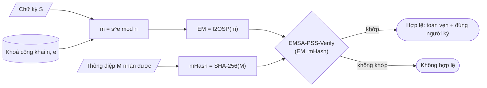
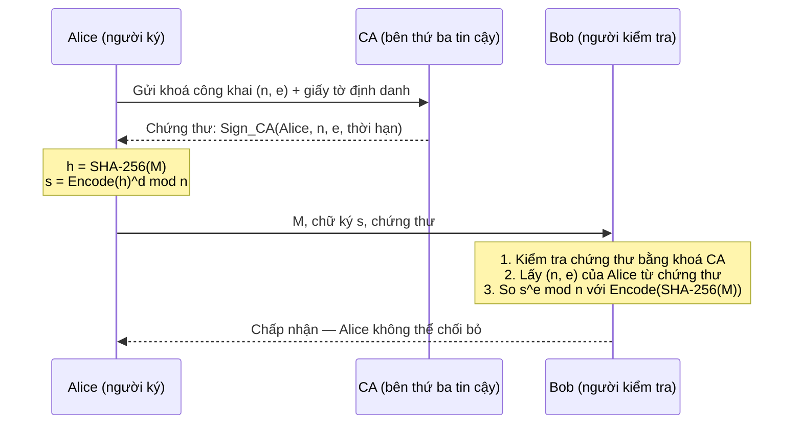
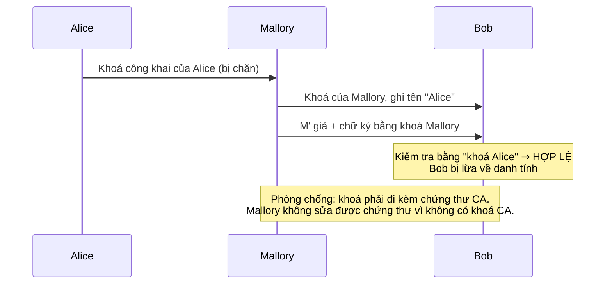
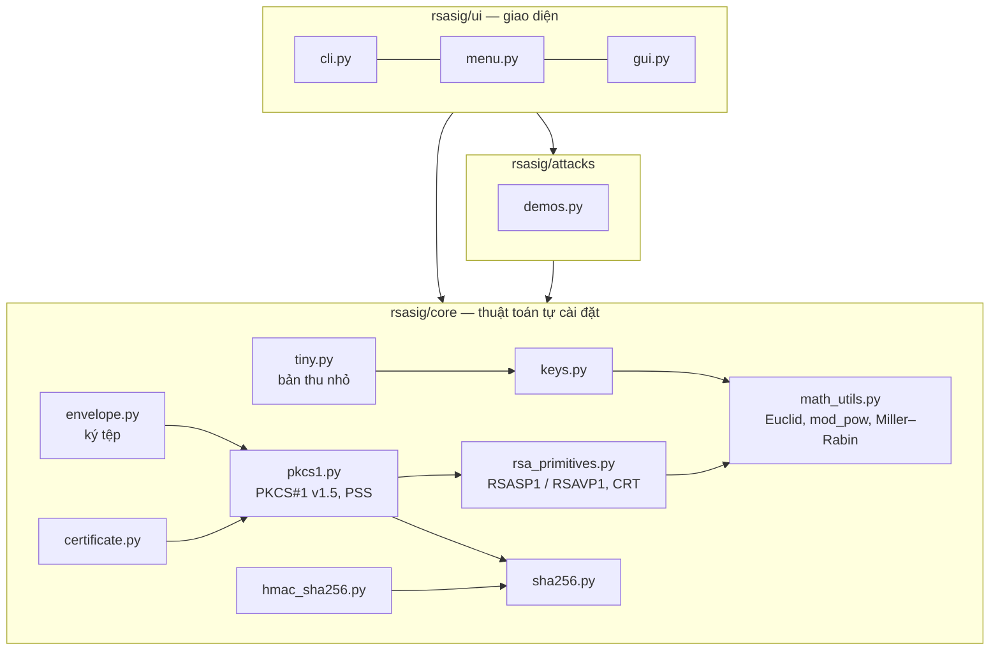

# Sơ đồ khối

Các sơ đồ viết bằng Mermaid (GitHub hiển thị trực tiếp). Để chèn vào báo cáo/slide:
dán vào <https://mermaid.live> → *Export PNG/SVG*, hoặc `npx @mermaid-js/mermaid-cli -i so-do.md`.

## 1. Sinh khoá

```mermaid
flowchart TD
    A([Bắt đầu: số bit k, e = 65537]) --> B[Sinh ngẫu nhiên số lẻ k/2 bit<br/>đặt 2 bit cao = 1]
    B --> C{Chia thử cho<br/>số nguyên tố nhỏ}
    C -- chia hết --> B
    C -- không --> D{Miller–Rabin<br/>40 vòng}
    D -- hợp số --> B
    D -- nguyên tố --> E[Được p; lặp lại để được q ≠ p]
    E --> F["n = p·q ; φ(n) = (p−1)(q−1)"]
    F --> G{"gcd(e, φ(n)) = 1 ?"}
    G -- không --> B
    G -- có --> H["d = e⁻¹ mod φ(n)<br/>(Euclid mở rộng)"]
    H --> I["dP = d mod (p−1), dQ = d mod (q−1)<br/>qInv = q⁻¹ mod p"]
    I --> J([Khoá công khai (n, e)<br/>Khoá bí mật (n, d, p, q, dP, dQ, qInv)])
```

## 2. Ký trên giá trị băm (RSASSA-PSS)

```mermaid
flowchart LR
    M[/Thông điệp M/] --> H["SHA-256<br/>mHash = H(M)"]
    H --> P["EMSA-PSS:<br/>salt ngẫu nhiên, M' = 0⁸‖mHash‖salt<br/>H' = H(M'), DB = PS‖01‖salt<br/>maskedDB = DB ⊕ MGF1(H')<br/>EM = maskedDB‖H'‖BC"]
    P --> I["m = OS2IP(EM)"]
    I --> S["s = m^d mod n<br/>(bình phương và nhân + CRT)"]
    K[(Khoá bí mật d)] --> S
    S --> O[/Chữ ký S = I2OSP(s, k)/]
```

## 3. Kiểm tra chữ ký



## 4. Tổng quan ký / kiểm tra giữa hai bên



## 5. Tấn công thay khoá công khai (kẻ đứng giữa)



## 6. Kiến trúc mã nguồn


